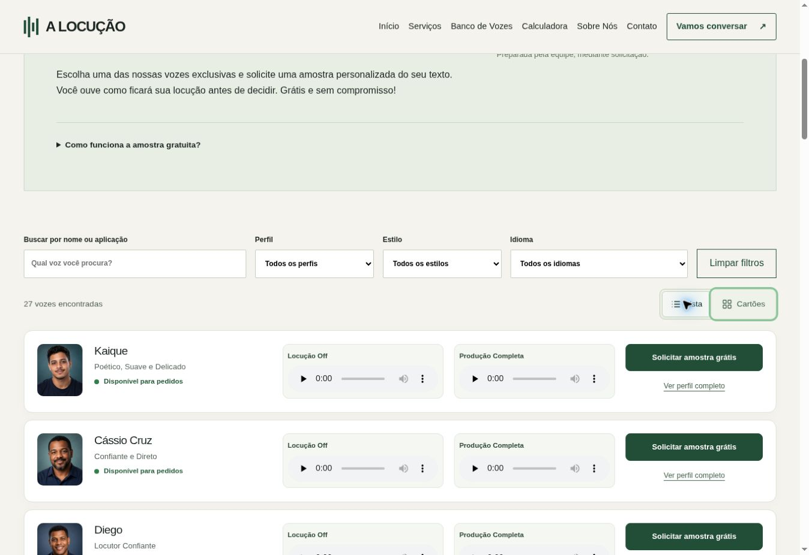
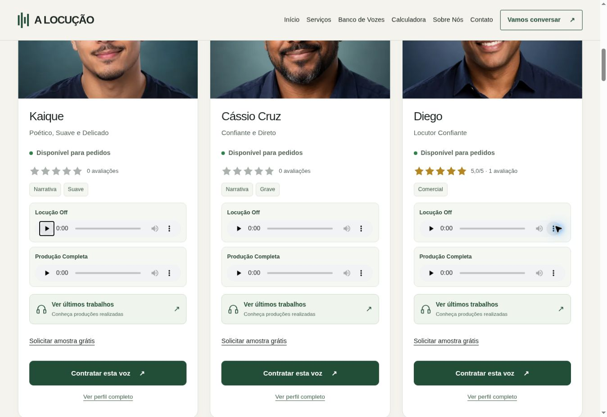
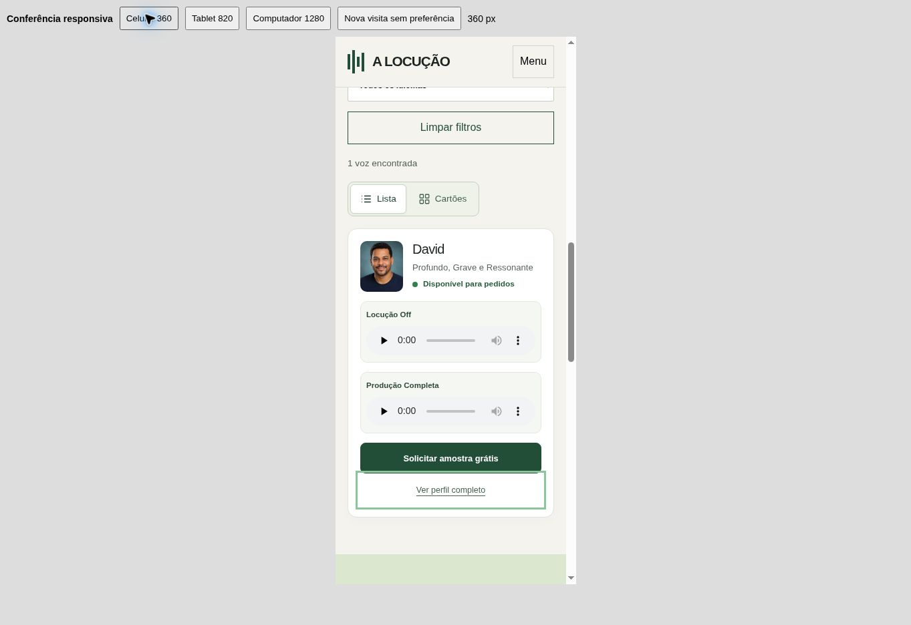
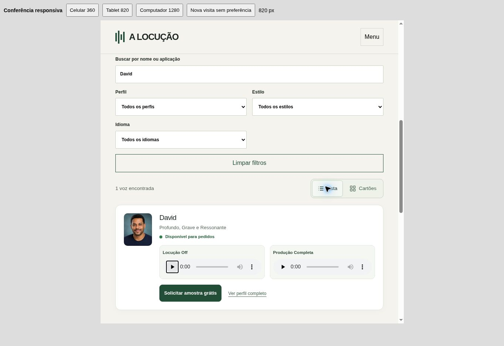

# Banco de Vozes — visualização híbrida

Preparado em 30/10/2026. Publicação pendente de autorização expressa do proprietário.

## Resultado

| Formato | Apresentação | Padrão inicial sem preferência salva |
| --- | --- | --- |
| Lista | Foto pequena, identificação, dois players e amostra gratuita em uma linha no computador | A partir de 1100 px |
| Cartões | Apresentação atual, fotos em destaque, avaliações, estilos e últimos trabalhos | Celular e tablet |

O visitante pode alternar a qualquer momento. A escolha explícita fica em `localStorage`, inclusive ao redimensionar a janela. Caso o armazenamento esteja indisponível, a escolha funciona durante a visita. Os mesmos elementos de áudio e locutores são reutilizados: alternar não refaz a ordem aleatória, não limpa filtros e não interrompe a reprodução.

A lista mantém o acesso ao perfil completo; avaliações, etiquetas e últimos trabalhos continuam nos cartões e nos perfis. Em telas intermediárias, a lista ocupa duas linhas; no celular, os players ficam empilhados. Não há tabela ou rolagem horizontal obrigatória.

## Escopo e auditoria

Repositório: `testedomarcio/alocucao`, base `main`. O site usa HTML estático gerado por `scripts/build-nova.py`, dados em `data/new-voices.json`, estilo compartilhado `assets/nova.css` e filtros/pausa de áudio em `assets/nova.js`.

A alteração é aplicada somente ao Banco de Vozes canônico após a geração das páginas de compatibilidade. Cabeçalho, rodapé, metadados, URLs, catálogo, avaliações, fotos, áudios e demais páginas permanecem iguais à base. Sem dependências novas. O CSS e o JavaScript adicionais somam aproximadamente 6 KB sem compressão, carregados somente em `/vozes/`.

Catálogo preservado: **27 vozes, sendo 26 em português e 1 em inglês**. As **54 referências de demonstração** continuam iguais. O indicador já existente “Disponível para pedidos” não promete conexão ou gravação imediata.

Observação preexistente: Thiago possui demonstração temporária de Produção Completa usando o mesmo Off. O aviso continua visível nos dois formatos; nenhum áudio foi substituído.

## Verificação

- `python3 scripts/build-nova.py`: 452 páginas e 27 perfis gerados; somente a página canônica do banco mudou entre as páginas publicáveis.
- `npm test`: passou integralmente, incluindo validação de páginas/SEO, filtros, ordem aleatória, pausa automática, calculadora, avaliações e rastreamento comercial.
- `node scripts/test-voice-bank-view.cjs`: padrões responsivos, estados acessíveis, alternância, preferência persistente, armazenamento inválido/bloqueado e redimensionamento.
- `node --check assets/voice-bank-view.js`, compilação do módulo Python e `git diff --check`: passaram.
- FFprobe: todas as 54 referências apontam para áudios existentes, decodificáveis e com duração positiva.
- Comparação com a base: markup de áudio e imagem, links de perfis/WhatsApp, metadados, dados de filtro, cabeçalho e rodapé preservados.
- Navegador Chrome: 27 itens/54 players; todas as opções de Perfil (3), Estilo (6) e Idioma ativo (2) testadas em ambos os formatos, com contagens corretas (22 combinações individuais).
- Busca David, filtros combinados Feminina/Comercial/Português (5 resultados), inglês (Lucan Rook), estado vazio e limpar filtros: passaram.
- Alternância com filtros e comparação da ordem antes/depois: passaram.
- Reprodução real de David Off e Produção Completa: tempo avançando, mídia pronta e pausa automática do anterior confirmados.
- Teclado: botões de visualização e controles nativos de áudio operáveis, foco visível e estado `aria-pressed` atualizado.
- Larguras de viewport 360, 820 e 1363 px: ambos os formatos conferidos, sem transbordamento horizontal. No celular/tablet a simulação usou iframe na largura indicada, não hardware físico.
- Persistência após recarregar: confirmada. Padrão sem preferência no celular/tablet: Cartões.
- CTA: destino existente `wa.me/5527996529832` e nome da voz preservados em todos os 27 itens; nenhuma mensagem enviada. Link “Ver perfil completo” de David aberto com sucesso; demais destinos conferidos por validação estática.

Não foi realizada medição Lighthouse/Core Web Vitals, teste em Safari/Firefox ou auditoria com leitor de tela. Os controles de áudio nativos e o carregamento `preload="none"` foram mantidos. Não houve alterações em imagens/áudio ou adição de biblioteca.

## Capturas

### Lista no computador

### Cartões preservados

### Lista no celular (viewport 360 px)

### Lista no tablet (viewport 820 px)

## Publicação

A branch de revisão não deve ser mesclada nem publicada sem autorização final. Nenhum deployment foi iniciado por este trabalho.
