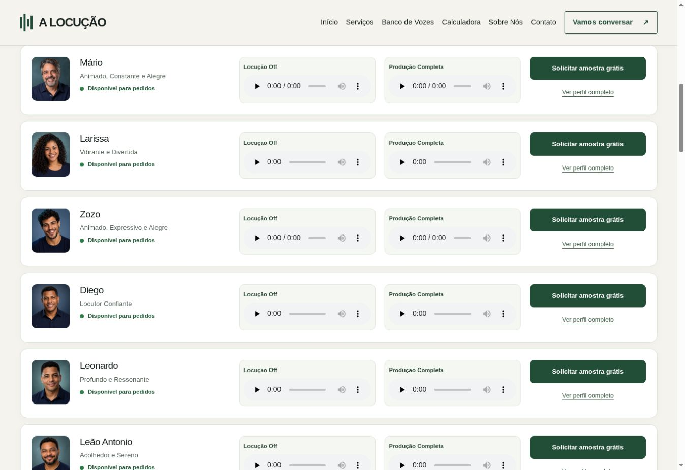
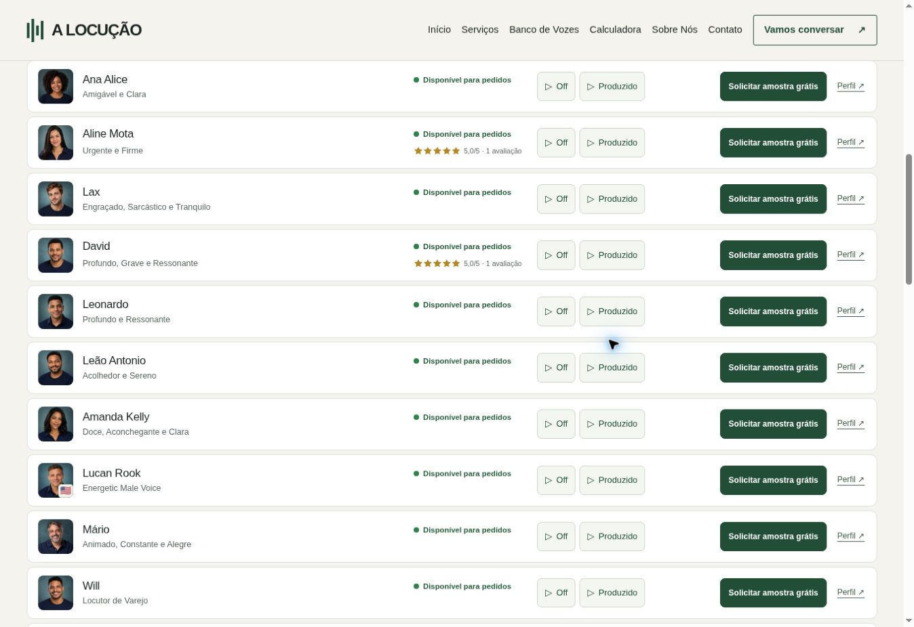
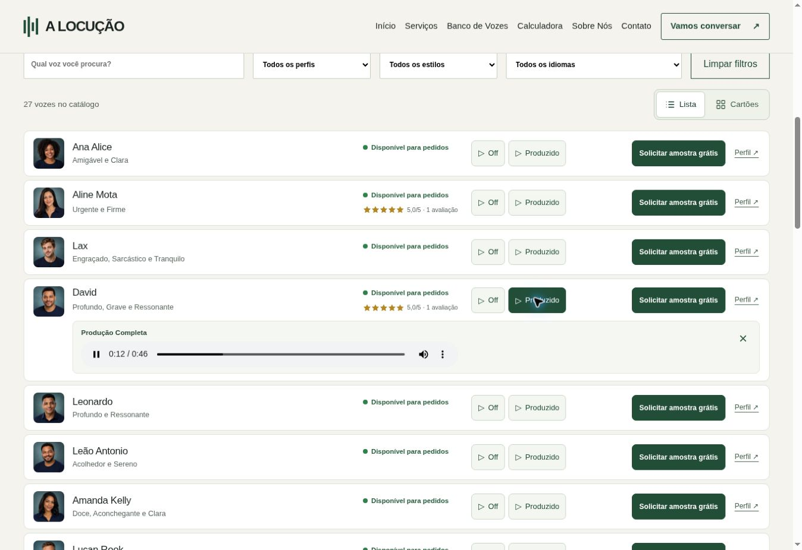
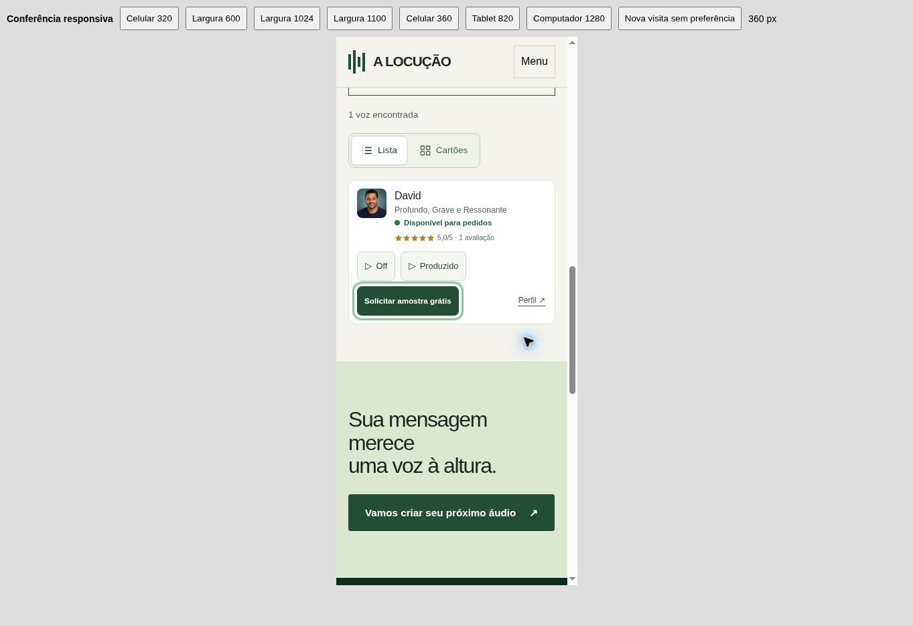

# Refinamento da lista — A Locução

Implementação preparada em 30/10/2026. **Não publicar nem mesclar sem a aprovação final do proprietário.**

## Comparação com a versão publicada

| Aspecto | Lista anterior | Lista refinada |
| --- | --- | --- |
| Altura comum no computador | 139 px | 78 px com player fechado |
| Intervalo entre itens | 12 px | 6 px |
| Capacidade aproximada em 800 px de resultados | 5 linhas completas | 9 linhas completas |
| Demonstrações | Dois players permanentemente visíveis | Botões Off / Produzido; um player aberto por vez |
| Avaliações | Ocultas na lista | Estrelas e nota/contagem reais nas 7 vozes avaliadas |
| Conversão | CTA e perfil empilhados | CTA de 44 px e link Perfil na mesma linha |
| Celular, David em Lista | 433 px | Aproximadamente 216 px com player fechado |

As linhas comuns ficaram cerca de 44% menores. A densidade de linhas fechadas por área aumentou aproximadamente 80%, incluindo a redução do intervalo entre itens. A altura aumenta somente no item cuja demonstração está aberta. As capturas usam a mesma largura; a ordem das vozes muda entre visitas por causa do embaralhamento inicial já existente.

## Interação do áudio

- Clicar em Off ou Produzido abre a demonstração correspondente e solicita reprodução. Nenhum áudio começa sem uma ação explícita do visitante.
- O player nativo existente é reutilizado: não há duplicação nem alteração dos arquivos.
- Clicar novamente no botão selecionado, no × do painel ou pressionar Esc dentro do item recolhe e pausa a demonstração. O botão de fechar e Esc devolvem o foco ao botão da demo.
- Abrir outra demonstração recolhe e pausa a anterior, inclusive entre locutores diferentes.
- O ponto de reprodução é preservado ao recolher; não é zerado automaticamente.
- A alternância Lista/Cartões conserva a reprodução. Ao voltar para Lista, uma demo em reprodução fica aberta.
- Filtrar e ocultar o locutor em reprodução pausa e recolhe sua demo.
- Se o navegador recusar a solicitação de reprodução, os controles nativos continuam disponíveis. Mensagens de falha de áudio já existentes foram preservadas.
- Sem animação de altura ou bibliotecas novas. O carregamento `preload="none"` foi mantido.

## Preservação

As **27 vozes e 54 elementos de áudio originais** permanecem intactos. As URLs, atributos de áudio/imagens, metadados, dados de busca/filtros, avaliações e destinos de WhatsApp foram comparados com a base. Não houve alteração nos preços, calculadora, perfis individuais, cabeçalho, rodapé ou demais páginas.

Somente a apresentação em Lista é alterada. Os novos controles ficam ocultos nos Cartões, que mantêm os dois players, avaliações, fotos, etiquetas, últimos trabalhos e ações existentes. O padrão continua Lista em desktop a partir de 1100 px e Cartões nas telas menores; a preferência explícita é salva e respeitada.

A classificação de avaliações apenas identifica os dados reais já renderizados: David, Diego, Fernanda, Aida, Enzo, Aline Mota e Christine. A nota 3/5 de Fernanda foi mantida, assim como todas as demais notas. Locutores sem avaliação não exibem estrelas vazias na lista.

A demonstração temporária de Produção Completa de Thiago continua usando o mesmo Off, com o aviso original visível quando aberta. Essa condição preexistente não foi alterada.

## Validação

- Build: 452 páginas geradas e 27 perfis; entre as páginas publicáveis, somente `/vozes/` mudou.
- `npm test`: validação de HTML/SEO, filtros, áudio, embaralhamento, calculadoras, avaliações e rastreamento comercial aprovados.
- `node scripts/test-voice-bank-view.cjs`: preferência, responsividade, armazenamento bloqueado/inválido e ciclo dos players aprovados, incluindo um painel por vez, pausa, posição preservada, foco, Esc, alternância e filtro de voz em reprodução. O teste foi incluído na validação de Pull Requests.
- Sintaxe JavaScript, compilação Python e `git diff --check` aprovados.
- Navegador: reprodução real de Off e Produção, troca de locutor, fechamento, Esc, pausa após filtro e continuidade ao alternar para Cartões e voltar confirmados.
- Todos os filtros ativos (3 perfis, 6 estilos e 2 idiomas), nos dois formatos: 22 verificações aprovadas; busca David, estado vazio, limpar e busca preservada na alternância também aprovados.
- Cards de David, Aida, Thiago, Lucan Rook e Christine: mesmas alturas naturais que a versão anterior na mesma largura e com a mesma busca. Os 54 players ficam visíveis em Cartões.
- Viewports simulados em iframe de 320, 360, 600, 820, 1024, 1100 e 1280 px, além do desktop de 1363 px: ambos os formatos sem transbordamento horizontal.
- Reprodução de Produção no viewport móvel confirmada com tempo avançando e mídia pronta.
- CTA: os mesmos destinos `wa.me/5527996529832` com identificação de voz foram preservados; nenhuma mensagem foi enviada. Os destinos dos 27 perfis permanecem iguais.

Limites: testes visuais em Chrome com tamanhos simulados, sem hardware móvel físico, Safari/Firefox, leitor de tela ou medição Lighthouse/Core Web Vitals.

## Capturas

### Antes

### Depois, players recolhidos

### Demonstração aberta

### Lista no celular

